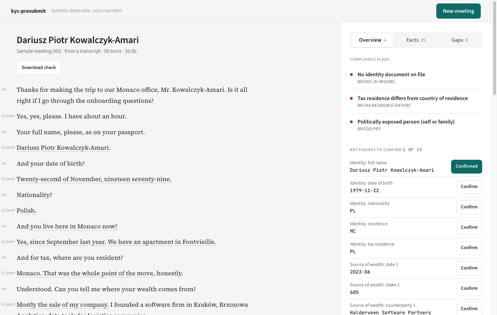
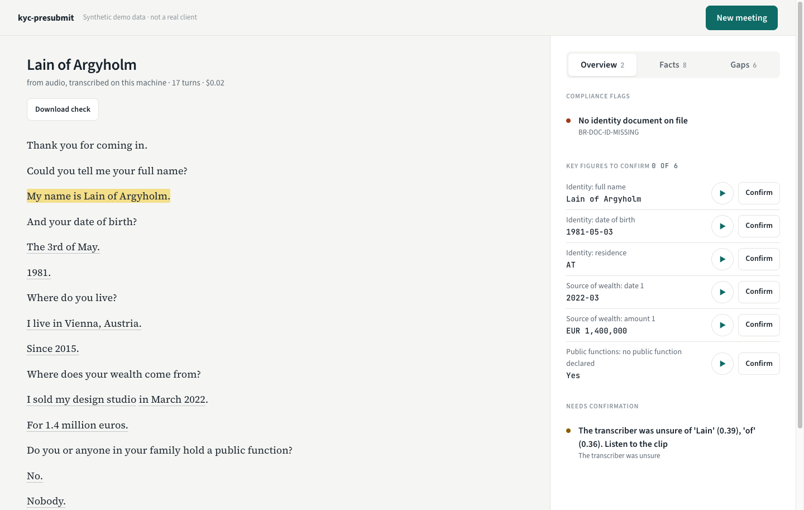

# kyc-meeting-copilot

**A pre-submission check for private-bank onboarding.** It reads the meeting where a relationship manager first interviews a client, and before the file goes to compliance it says what's missing, what doesn't add up, and which compliance flags will fire. Every fact it reports quotes the client's own words.

*All data in this repository is synthetic. No real people, clients or companies.*



## The problem

Opening an account for a wealthy client is a regulated process. Before the bank takes the money, it has to know who the client is, where their wealth came from, whether they or their family hold public office, and whether the story holds together. That is KYC (know your customer), and under EU anti-money-laundering rules it is the bank's legal duty, not a formality.

The facts come from a conversation. A relationship manager (RM) meets the client, asks the onboarding questions, takes notes, and writes up the file. Compliance then reviews it, and often sends it back:

- the date of birth was never written down;
- the source of wealth says "sale of a company" but not when, for how much, or who bought it;
- the client mentioned a sister in government, and nobody recorded it;
- the client said Monaco for tax at the start of the meeting and Poland at the end, and the file has one of them.

Each return is a round trip: the RM goes back to the client, the client waits, compliance reviews again. The client's first experience of the bank is a delay, the RM spends time on rework instead of clients, and compliance reviews the same file twice. Almost none of it is a judgement call. It is information that was said, or never said, in a meeting that already happened.

## What the tool does

Give it a recording or a transcript of that meeting. In about a minute it returns:

- **every KYC fact the client stated, each linked to the exact words**, so anyone can check it in seconds;
- **what was never said** and must still be asked, against what onboarding requires;
- **what doesn't add up**: an answer the client changed, a value that contradicts what the bank already holds, funding larger than all the wealth described, a date in the future;
- **the compliance flags the facts trigger** (a politically exposed relative, a foundation or trust, a large uncorroborated source of wealth), each rule citing the public regulation it comes from;
- **the key figures to confirm**, each with a play button for the seconds of audio it came from.

The RM fixes the file while the meeting is fresh, often before the client has left. Compliance receives a fuller file, with evidence behind every line.

It never decides anything for compliance. It doesn't score risk, approve or reject. It prepares the person who does the work.

## Who it's for, and why it matters

- **The RM** gets a checklist of what to fix, built from their own meeting, instead of finding out days later.
- **Compliance** gets a first submission that is more complete, and can see where each fact came from instead of trusting a summary.
- **The bank** gets faster onboarding, fewer review cycles per file, and an audit trail: every fact traceable to a moment in the meeting, every flag traceable to a rule and its source.
- **The client** gets asked once.

The timing helps. The EU's single AML rulebook, Regulation 2024/1624, applies from July 2027, and banks across the EU are reworking onboarding to it. A check that encodes the rulebook's requirements as testable rules, with sources, fits that work.

## The premises

The project only makes sense if five things are true. Code can test some of them; the rest need the outside world. This is where each stands:

| # | Premise | How it is tested | Status |
|---|---|---|---|
| 1 | **Bounces are common and costly** enough that RMs and compliance want them caught earlier. | Interviews with RMs and compliance officers at several banks. | **Open.** It comes from practitioners, but it has not been measured. |
| 2 | **Most bounces are mechanical**: missing, inconsistent or unrecorded information, detectable from the meeting itself, not judgement calls. | The bounce rules (nine, each from public regulation) and the trap catalogue, both built with a domain expert. | **Supported** by the domain work; to be confirmed in interviews. |
| 3 | **A model can extract the facts reliably,** with real quotes and no wrong important value passing silently. | `kyc-eval` against bars fixed before any paid run. | **Holds on clean transcripts** (results below). |
| 4 | **Real meetings can be captured well enough.** A misheard number becomes a confident wrong fact. | Recordings of role-played meetings in real rooms, two transcribers side by side. | **Open, and the main risk.** Defences are built; real recordings are the test. |
| 5 | **The data may be used this way**: a legal basis for processing meeting audio and transcripts for this purpose. | Legal review. | **Open.** Hence synthetic data only. |

So the honest summary: the technical bet (3) works on clean input; the business case (1, 2) is plausible and needs evidence from practitioners; and the product stands or falls on capture (4) and the legal basis (5).

## What it has shown

Scored against bars fixed before the first paid run ([preregistration](eval/preregistration.md)):

| | Bar | Private set: 12 cases by a domain expert, 4 runs | Public set: 6 cases in this repo, 5 runs |
|---|---|---|---|
| Important facts found (critical recall) | ≥ 85% | 98–99% | 97–98% |
| Facts that are correct (precision) | ≥ 90% | 94–96% | 95–97% |
| Wrong important values with no warning | 0 | **0 in every run** | 0, 2, 0, 1, 1 |
| Quotes that aren't the client's real words | ≤ 5% | 0 | 0 |
| Expected compliance flags raised | ≥ 90% | 100%, none wrongly | 100%; one known false flag |

About $0.04 a meeting with `claude-opus-5-5`.

The silent wrong values on the public set were not misheard figures. One was a correct public role worded with more detail than the strict grader accepts; the other came from a field nobody had defined (is an inheritance's counterparty the grandmother, or the notary who settled the estate?). They are listed one by one in [docs/evaluation.md](docs/evaluation.md), and nothing was changed after seeing them.

**Capture is the real weakness.** On a noisy transcript, every planted mishearing became a confident wrong fact, and the model's own confidence didn't flag any of them. So three defences sit outside the model: a plausibility check in code (values that can't all be true), the transcriber's own doubt about each word, and confirm-by-ear for every key figure.



## How it works

```
recording ──► local Whisper (word timings and confidence) ──┐
transcript ─────────────────────────────────────────────────┴─► utterances
                                                                    │
                   ┌── Claude, structured output: candidate facts, each with a quote
                   ▼
   code: is every quote really in the transcript?  (no → retry once, then reject)
   code: reconcile against the bank's file ─► contradictions (never resolved automatically)
   code: plausibility                        ─► "can't all be true" doubts
   code: transcriber doubt on quoted words   ─► "listen to the clip"
   code: compliance rules (public sources)   ─► flags
   code: required fields with no fact        ─► gaps
                   ▼
   viewer: transcript ⇄ facts, key figures with play and confirm, downloadable report
```

The model does one job: read the conversation and propose facts with quotes. **Everything that decides anything is plain code**, versioned and tested, because a compliance file needs answers that are the same every time and can be explained line by line. Audio is transcribed on the machine and never leaves it. More in [docs/architecture.md](docs/architecture.md) and the [decision records](docs/decisions.md).

## The domain work behind it

Most of the effort is not the model call. It is knowing what compliance will send back, and writing it down so code can check it:

- **A fact taxonomy** of 32 fields: which onboarding requires, which are critical (a wrong value is worse than a missing one), how a changed answer or a relative date is kept.
- **Nine bounce rules**, each citing its source: the EU AML Regulation 2024/1624, the OECD Common Reporting Standard, FATF statements. The loader refuses a rule without a public source ([sources](src/kyc_copilot/rules/SOURCES.md)).
- **A trap catalogue** for test cases: a self-corrected amount, a PEP relative mentioned after "no PEPs", a legal owner mistaken for the beneficial owner, a health disclosure that must never become a fact, a client who changes an answer mid-meeting ([authoring guide](cases/AUTHORING.md)).
- **Twelve invariants** the system must never break, each traced to a test: no fact without provenance, contradictions never resolved automatically, sensitive topics never stored ([spec](docs/spec.md)).

The private case set was written by a practising wealth-management domain expert, who prefers not to be named; those cases are not published. The six public cases were written for this repository and cover most of the same traps.

## Try it

Needs Python 3.12+ and [uv](https://docs.astral.sh/uv/).

```bash
git clone https://github.com/NassarX/kyc-meeting-copilot && cd kyc-meeting-copilot
uv sync --extra viewer
uv run pytest -q                       # fakes only: no key, no network, no spend
uv run kyc-eval run --pipeline gold    # every case checked against the rules
```

With an Anthropic API key in `.env` (copy `.env.example`):

```bash
uv run kyc-check --transcript viewer/samples/D02-pep-and-changed-answer.txt --meeting-date 2026-11-09
uv run kyc-eval run --pipeline model --cap 1.0      # the full eval, about $0.50
uv run kyc-viewer                                    # http://127.0.0.1:8000 → New meeting → Load a sample meeting
```

Audio needs Apple Silicon for the local transcriber: `uv sync --extra audio --extra viewer`, then record or upload in the viewer. To share the viewer behind a password and a spend budget, see [viewer/README.md](viewer/README.md).

## What's here

| Path | What |
|---|---|
| `src/kyc_copilot/extract.py` | The model call: prompt, structured output, quote check, retry, cost cap, cache |
| `src/kyc_copilot/reconcile.py`, `plausibility.py`, `rules/` | The code that decides: contradictions, doubts, compliance rules |
| `src/kyc_copilot/capture.py` | Local Whisper with per-word timing and confidence |
| `src/kyc_copilot/eval/` | Case format, graders, scorecard, `kyc-eval` |
| `src/kyc_copilot/viewer.py`, `viewer/` | The web app |
| `src/kyc_copilot/service.py`, `store/`, `workflow/` | The case state machine and append-only store: the foundation for the human sign-off steps, not yet wired to the viewer |
| `cases/` | The public test cases and how to write one |
| `eval/` | Preregistration, scorecards, audio test tools |
| `docs/` | Spec, architecture, evaluation, decisions; design system in [DESIGN.md](DESIGN.md) |

## Limits

- A proof of concept on synthetic meetings. It has not seen a real meeting, and premises 1, 4 and 5 are untested.
- No blind test cases yet: everyone who wrote cases had seen the rules.
- Amount thresholds compare in EUR only; there is no currency conversion.
- The free-text grader is strict and some field meanings are undefined; both show up as silent wrong values that aren't misreadings.
- A relative's long-past or minor public role can still raise a PEP flag. It errs toward an extra review, never a missed one.
- The human sign-off steps, the independent checker and the source-of-wealth narrative in the spec are not built.

## Licence

MIT, see [LICENSE](LICENSE). Third-party parts (ideas adapted from gbrain, the OFL fonts) are listed in [NOTICE.md](NOTICE.md).
